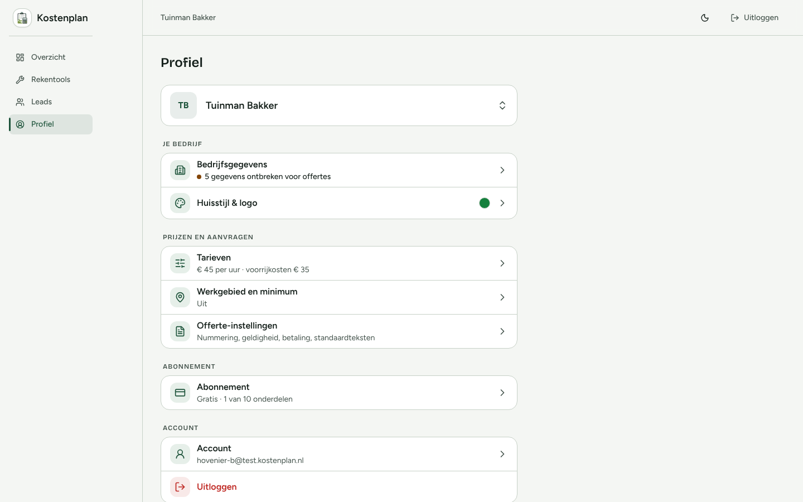
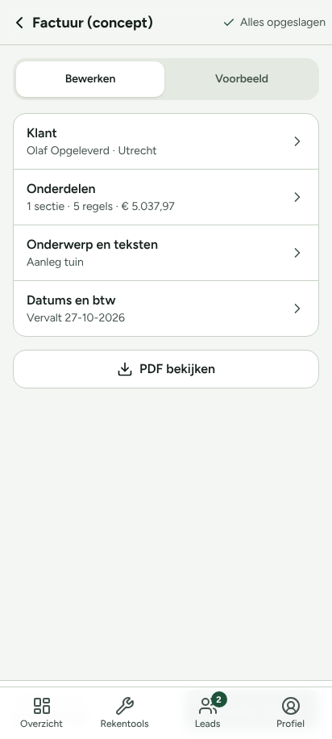
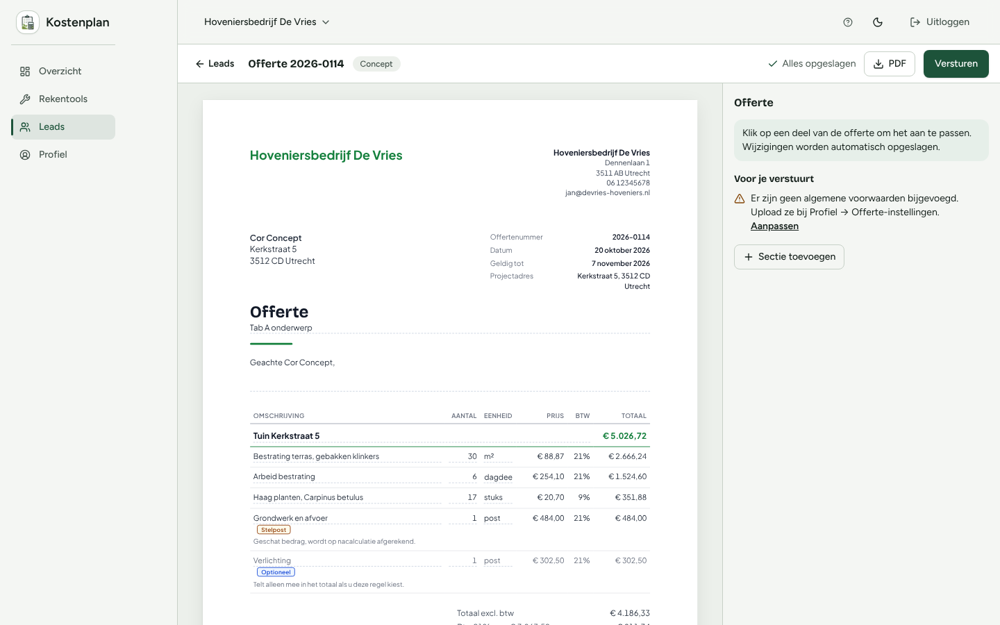
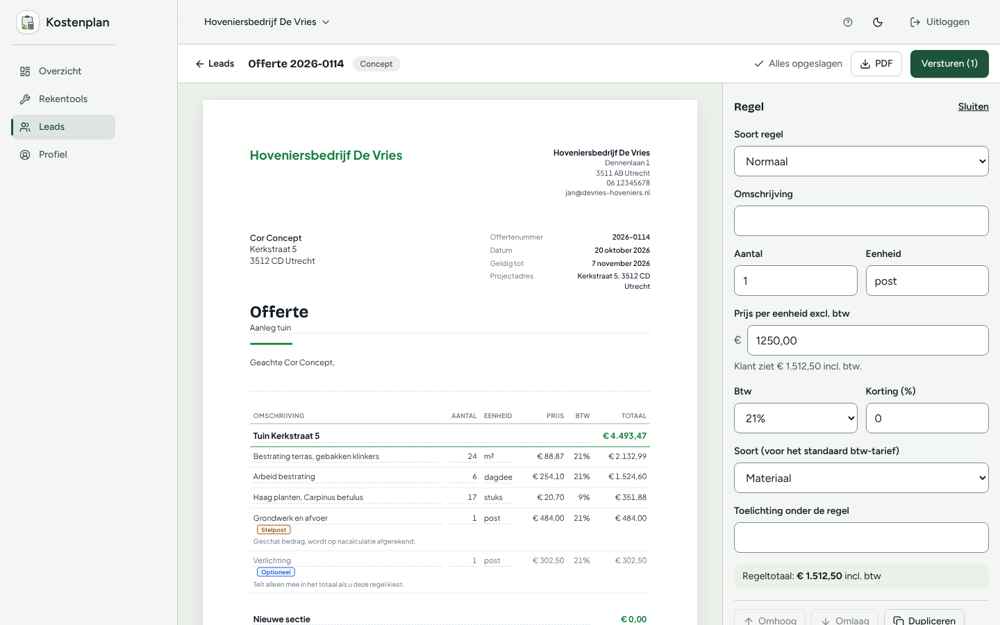
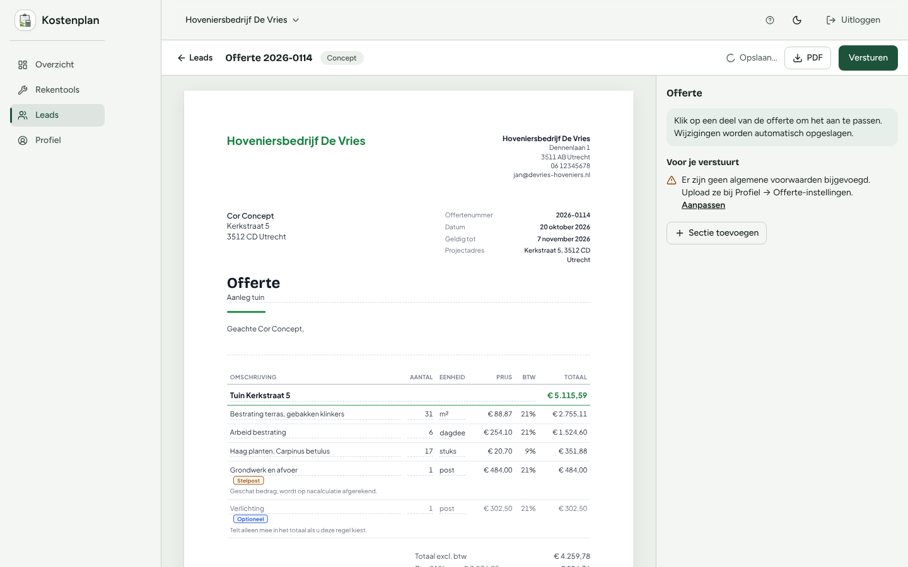
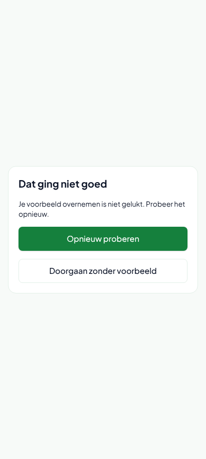
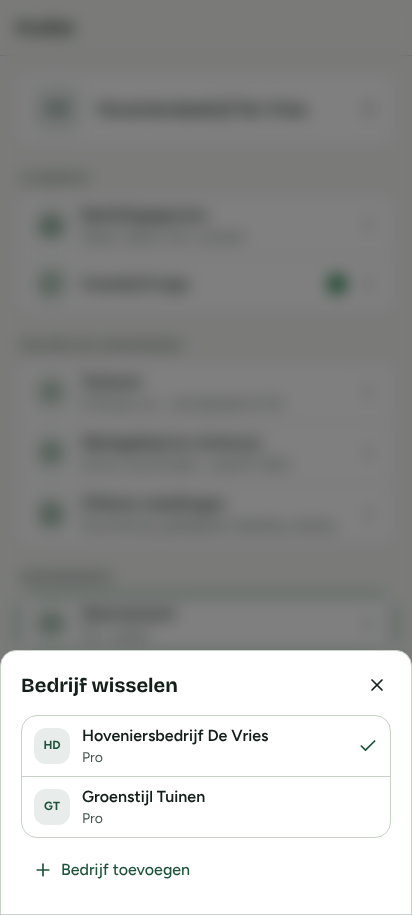
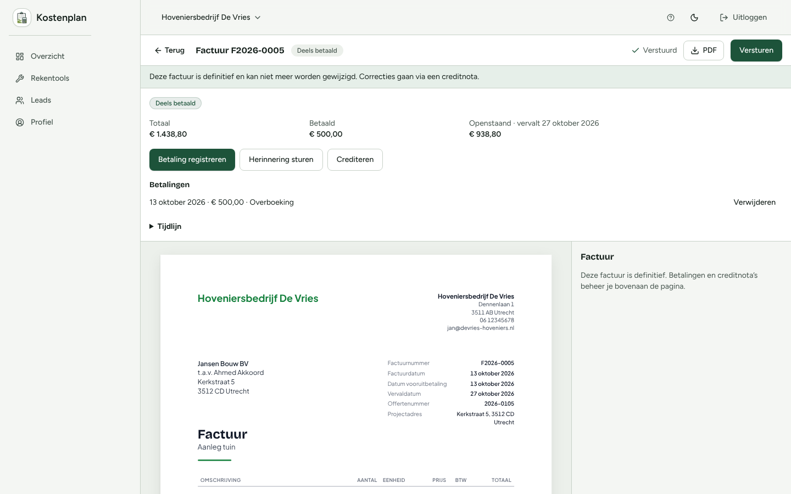
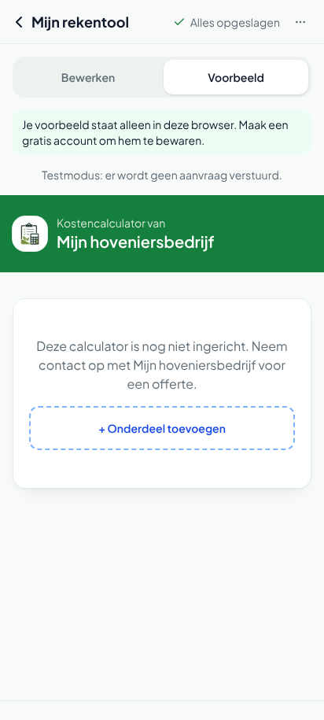
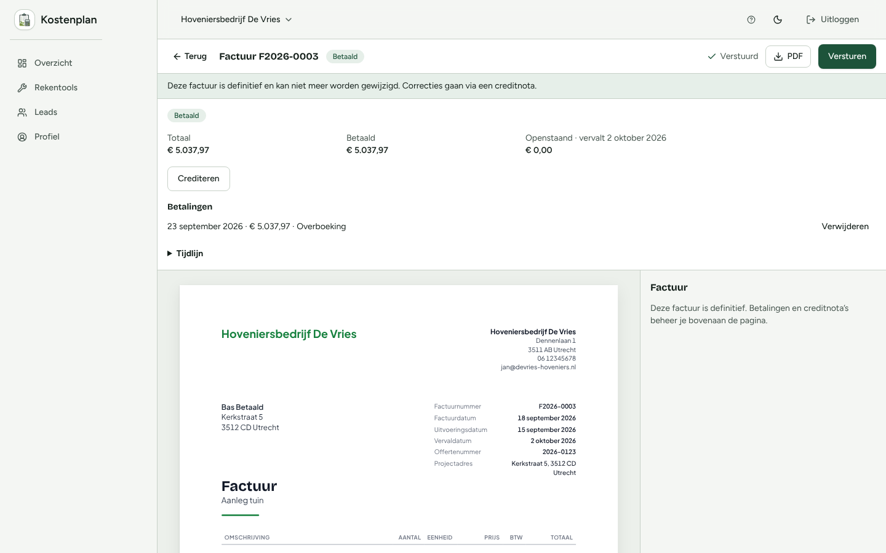

# Testrapport 2026-10-13

Omgeving: lokale testomgeving (zie docs/testing.md). Ruwe meldingen: 139. Bevestigd: 78, onzeker: 3, verworpen: 38, samengevoegd als dubbel: 22, niet geverifieerd: 1.

## Samenvatting

| Prioriteit | Aantal |
| --- | --- |
| P0 | 5 |
| P1 | 7 |
| P2 | 27 |
| P3 | 39 |

### Per gebied

| Gebied | P0 | P1 | P2 | P3 |
| --- | --- | --- | --- | --- |
| a11y | 0 | 1 | 2 | 7 |
| bug | 4 | 3 | 8 | 3 |
| copy | 0 | 0 | 2 | 19 |
| document | 0 | 1 | 5 | 0 |
| pricing | 0 | 1 | 3 | 1 |
| security | 1 | 0 | 0 | 0 |
| ui | 0 | 0 | 0 | 1 |
| ux | 0 | 1 | 7 | 8 |

## Top 10

### 1. [P0] registreerBetalingAction: hovenier B kan een betaling registreren op een factuur van hovenier A (companyId-check werkt niet)

- Gebied: security · gebruiker b · 1440x900 · http://localhost:3200/dashboard/profiel
- Verwacht: De server-action hoort te weigeren met 'Factuur niet gevonden' (zoals de andere facturen-acties terecht doen), omdat de opgegeven factuurId niet bij het actieve bedrijf van de aanroeper (B) hoort.
- Werkelijk: De betaling werd geaccepteerd en echt opgeslagen op de factuur van hovenier A1: een niet-gelieerde gebruiker (B) kan zo de betaalstatus van een andere hovenier se factuur manipuleren (valse betaling registreren, status laten omslaan naar 'Deels betaald' of 'Betaald'). Oorzaak (codelezing ter duiding, niet als los bewijs): in app/lib/factuur/beheer.ts controleert registreerBetaling() de company-eigenaarschap alleen via een ongecontroleerd resultaat van een losse 'vergrendel' SELECT ... FOR UPDATE (companyId wordt niet op de return-waarde gecontroleerd) en laadStand() haalt de factuur daarna op met db.factuur.findUniqueOrThrow({ where: { id: factuurId } }) zonder companyId-filter, dus elke ingelogde gebruiker kan op elke factuur-id een betaling registreren.
- Stappen: Ingelogd als hovenier B (gebruiker b, eigen bedrijf cmv6xymrp00dx0s7dievhmt3g, heeft zelf geen facturen). → Action-id van registreerBetalingAction opgezocht in de Next.js server-reference-manifest van de build (.next/server/app/dashboard/facturen/[factuurId]/page/server-reference-manifest.json): 406f9fbbf7ff50de4da2d8dbf877756ed5488bff6a. → Rechtstreeks (geen UI) POST naar http://localhost:3200/dashboard/profiel met header 'Next-Action: 406f9fbbf7ff50de4da2d8dbf877756ed5488bff6a', content-type 'text/plain;charset=UTF-8', accept 'text/x-component', als body: [{"factuurId":"cmv6xylu2002q0s7d50xeclpw","bedragCenten":100000,"datum":"2026-10-13","methode":"OVERBOEKING","notitie":"attacker payment"}] — factuurId is de 'verstuurd'-factuur van hovenier A1 (bedrijf cmv6xylif00000s7d4ckr8z9w), bekend uit test-results/seed.json, nooit aan B getoond. → Response: HTTP 200, body bevat '1:{"ok":true}'. → Read-only controle in de database (alleen ter verificatie): SELECT ... FROM "FactuurBetaling" WHERE "factuurId"='cmv6xylu2002q0s7d50xeclpw' → nieuwe rij cmv6yjln400e77b7dvs1z9xr5, bedragCenten=100000, methode=OVERBOEKING, notitie='attacker payment', companyId via factuur = cmv6xylif00000s7d4ckr8z9w (A1's bedrijf); de factuurstatus staat nu op DEELS_BETAALD. → Ter vergelijking, in dezelfde sessie als B geprobeerd: maakCreditnotaAction en definitiefMakenAction op facturen van A1 → beide correct geweigerd met {"ok":false,"error":"Factuur niet gevonden."}; alleen registreerBetalingAction faalt.
- Vermoedelijke oorzaak: app/lib/factuur/beheer.ts: vergrendel() (regel ~38) voert een raw SELECT ... WHERE id=... AND companyId=... FOR UPDATE uit maar het resultaat wordt nergens gecontroleerd (geen rijen terug betekent geen fout); registreerBetaling() (regel ~40-46) roept vergrendel() aan en negeert de returnwaarde, en laadStand() (regel 16-17) haalt de factuur daarna op met db.factuur.findUniqueOrThrow({ where: { id: factuurId } }) zonder companyId-filter. Daardoor kan elke ingelogde gebruiker, met alleen de factuur-id, een betaling registreren op een factuur van een ander bedrijf.
- Herhaalscript: `test-results/repro/verifier-05-registreerBetaling-b-op-a2.js`

### 2. [P0] Factuur-editor mobiel: Definitief maken onder tabbalk

- Gebied: bug · gebruiker a1 · 412x915 · about:blank
- Verwacht: De vaste actiebalk met 'Definitief maken' is zichtbaar en klikbaar boven de onderste tabbalk.
- Werkelijk: De balk (top 842 px) ligt achter de tabbalk (NAV top 850 px). De knop 'Definitief maken' (855-903 px) is niet zichtbaar; op het middelpunt van de knop geeft elementFromPoint de tab 'Profiel' terug. Zichtbaar zijn alleen de vier tabs. Zelfde op 360x780 (knop 720-768 px, bedekt door '2 Leads'/'Profiel').
- Stappen: Log in als a1, open /dashboard/facturen/cmv6wdxgz002hq47dvwumrrkr op 412x915 → Scroll naar onder → Kijk naar de vaste balk met 'Totaal incl. btw' en 'Definitief maken'
- Vermoedelijke oorzaak: app/components/mobile/tabbalk.tsx verbergtTabbalk() verbergt de tabbalk alleen voor /dashboard/tools/<id> en /dashboard/leads/<id>/offerte; /dashboard/facturen/<id> ontbreekt, dus fixed nav (z-40, bottom-0, top 850) ligt over de StickyActiebalk in offerte-editor-v2.tsx (r.548/ r.564/657). Ook Herinnering sturen/Betaling/Crediteren (kop) wel bereikbaar.
- Toelichting prioriteit/samenvoeging: De hoofdactie van de factuur (Definitief maken/Versturen) is op mobiel onbereikbaar: blokkade. P0 volgens de definitie 'blokkade'. (verifier gaf P1)
- Herhaalscript: `test-results/repro/verifier-02-balk.js`

### 3. [P0] Offerte: wijziging in verouderd tabblad overschrijft stil de wijziging van het andere tabblad

- Gebied: bug · gebruiker a2 · 1440x900 · http://localhost:3200/dashboard/leads/cmv6xym4d00630s7d7rzjfxq8/offerte
- Verwacht: Wijziging van tab A blijft staan, of de gebruiker krijgt een melding dat de offerte in een ander tabblad is gewijzigd
- Werkelijk: Na herladen staat Onderwerp op 'Aanleg tuin' (tab A-wijziging weg), aantal regel 2 is 7 (tab B-wijziging wel). Geen melding in een van beide tabbladen.
- Stappen: Open concept-offerte a2 (Offerte 2026-0114) in tab A en tab B → Tab A: Onderwerp wijzigen naar 'Tab A onderwerp', blur; status 'Alles opgeslagen' → Tab B (nog met oud onderwerp 'Aanleg tuin'): Aantal van regel 2 wijzigen naar 7, blur; status 'Alles opgeslagen' → Tab A herladen
- Vermoedelijke oorzaak: bewaarOfferteAction(offerteId, laatste.current) in app/components/offerte/offerte-editor-v2.tsx stuurt de volledige inhoud zonder versie/updatedAt-controle; geen optimistic locking.
- Toelichting prioriteit/samenvoeging: Stil dataverlies door last-writer-wins bij twee tabbladen. P0 volgens de definitie 'dataverlies'. (verifier gaf P1)
- Herhaalscript: `test-results/repro/verifier-07-tabs.js`

### 4. [P0] Offerte: prijs '12.50' wordt opgeslagen als 1.250,00 (100x te hoog)

- Gebied: bug · gebruiker a2 · 1440x900 · http://localhost:3200/dashboard/leads/cmv6xym4d00630s7d7rzjfxq8/offerte
- Verwacht: Prijs 12,50 (of melding dat punt niet als decimaal wordt gezien)
- Werkelijk: Veld toont direct '1250,00'; na herladen regel-prijs € 1.512,50 incl. btw (= 1.250 excl.). Totaal van offerte verspringt met ruim € 1.500.
- Stappen: Offerte a2 concept: 'Sectie toevoegen', dan 'Regel toevoegen' → Prijsveld: typen '12.50', blur → Herladen
- Vermoedelijke oorzaak: offerte-paneel.tsx BedragVeld onChange: Number(v.replace(/\./g,'').replace(',','.')). Oplossing: bij exact een punt en max 2 decimalen erachter als decimaal lezen, of waarschuwing tonen bij ambigue invoer; bij meerdere scheidingstekens het laatste als decimaal.
- Toelichting prioriteit/samenvoeging: Fout bedrag: '12.50' wordt stil 1.250,00 (factor 100). P0 volgens de definitie 'fout bedrag'. (verifier gaf P1)
- Herhaalscript: `test-results/repro/verifier-07-prijs2.js`

### 5. [P0] Offerte: offline bewerken blijft 'Opslaan…' hangen zonder melding; wijziging is na weer online en herladen weg

- Gebied: bug · gebruiker a2 · 1440x900 · http://localhost:3200/dashboard/leads/cmv6xym4d00630s7d7rzjfxq8/offerte
- Verwacht: Duidelijke melding 'geen verbinding, wijziging niet opgeslagen' en opnieuw proberen na online komen; of wijziging blijft behouden
- Werkelijk: Status blijft 'Opslaan…' (spinner), geen foutmelding; na online blijft 'Opslaan…'. Na herladen: aantal 30 (oude waarde), onderwerp 'Aanleg tuin'. Console: 'pageerror: Failed to fetch'. Wijziging verloren.
- Stappen: Offerte a2 geopend, ctx offline → Aantal regel 1 naar 31 en Onderwerp naar 'Aanleg tuin offline', blur → Wacht 6 s, daarna weer online en 8 s wachten → Herladen
- Vermoedelijke oorzaak: bewaar() in offerte-editor-v2.tsx r.~105: await bewaarOfferteAction heeft geen try/catch, dus bij fetch-fout blijft opslag='opslaan' en wordt niets herhaald.
- Toelichting prioriteit/samenvoeging: Stil dataverlies bij offline bewerken (geen melding, geen retry). P0 volgens de definitie 'dataverlies'. (verifier gaf P1)
- Herhaalscript: `test-results/repro/verifier-07-edge.js`

### 6. [P1] Rekentool-overname na registreren geeft 'Dat ging niet goed' (500 op /probeer/importeren)

- Gebied: bug · gebruiker anoniem · 412x915 · http://localhost:3200/probeer/importeren
- Verwacht: Rekentool wordt overgenomen in het account en je komt in het dashboard (of in onboarding met de tool)
- Werkelijk: Overname mislukt: pagina 'Dat ging niet goed' met knoppen 'Opnieuw proberen' en 'Doorgaan zonder voorbeeld'. Browser-console: 'Failed to load resource: 500'; netwerk: 500 op /probeer/importeren. Ook na 'Opnieuw proberen' opnieuw 500.
- Stappen: Open /probeer, kies onderdelen, Volgende (of: tik via editor), Meer acties → Account maken → Vul nieuw e-mailadres en wachtwoord (min. 8 tekens) in, tik 'Gratis account aanmaken' → Scherm 'We nemen je rekentool over in je account…' blijft ~80 s staan → Scherm 'Dat ging niet goed / Je voorbeeld overnemen is niet gelukt.'
- Vermoedelijke oorzaak: Query (generateUniqueToolSlug via prisma) buiten de interactieve transactie op een pool met max: 1 (app/lib/actions/draft-import.ts: generateUniqueToolSlug gebruikt `prisma` i.p.v. `tx`, binnen prisma.$transaction). Fix: slug voor de transactie berekenen of de slug-lookup met tx uitvoeren; (de 5 s timeout zelf is niet de wortel: verhogen helpt niet, de impasse blijft).
- Herhaalscript: `test-results/repro/verifier-08-import.js (+ verifier-08-import-vervolg.js voor Opnieuw proberen / Doorgaan en Rekentools)`

### 7. [P1] Focus lekt uit Bedrijf wisselen (bottom sheet) op mobiel

- Gebied: a11y · gebruiker a1 · 412x915 · http://localhost:3200/dashboard/profiel
- Verwacht: Focus gaat naar de dialoog (bv. de sluitknop of eerste veld) en blijft erin (focus-trap); na Escape gaat focus terug naar de knop die de dialoog opende.
- Werkelijk: Na Enter staat focus nog op de knop ("button "Bedrijf wisselen, huidig: Hoveniersbedri" (in dialoog: false)"). Tab 1-6 gaan naar de pagina ACHTER de dialoog: a "Bedrijfsgegevens Naam, adres, KvK, conta" (in dialoog: false) \| a "Huisstijl & logo" (in dialoog: false) \| a "Tarieven € 45 per uur · voorrijkosten € " (in dialoog: false) \| a "Werkgebied en minimum 30 km rond Zwolle " (in dialoog: false) \| a "Offerte-instellingen Nummering, geldighe" (in dialoog: false) \| a "Abonnement Pro · actief" (in dialoog: false). Na Escape staat focus op: a "Abonnement Pro · actief" (in dialoog: false).
- Stappen: Open /dashboard/profiel op 412x915 met a1 → Focus op "Bedrijf wisselen", Enter (dialoog opent) → Zes keer Tab met toetsenbord → Escape
- Vermoedelijke oorzaak: app/components/ui/overlay.tsx (Overlay): alleen Escape-handler en body overflow hidden; geen focus naar dialoog bij openen, geen focus-trap, geen inert/aria-hidden op de rest, geen focus-restore. Variant Factuur maken (o484): sheet staat bovenop de lead-drawer (2 role=dialog); Tab blijft dan wel binnen de drawer maar niet in de sheet; na Escape focus op body.
- Herhaalscript: `test-results/repro/verifier-02-focus.js`

### 8. [P1] Geaccepteerde offerte: beheerscherm en gewone PDF tellen de door de klant gekozen optionele regel niet mee (getekende PDF, online pagina en factuur wel)

- Gebied: pricing · gebruiker a1 · 1440x900 · http://localhost:3200/dashboard/facturen/cmv6wukg3006g7b7dob4sn2wx
- Verwacht: Optionele regels die de klant niet kiest tellen niet mee in de termijn- of eindfactuur. Aanbetaling = € 1.123,69 excl. btw (30% van € 3.745,63).
- Werkelijk: De aanbetalingsfactuur F2026-0005 is € 1.198,69 excl. btw (€ 1.438,80 incl.). De eindfactuur (concept) toont de regel 'Verlichting € 250,00' als gewone regel en komt uit op € 2.796,94 excl. btw / € 3.357,17 incl. btw, terwijl de offerte 'Bij oplevering 70% € 2.621,94 excl. btw' aangeeft.
- Stappen: Log in als a1 (desktop). Open offerte 2026-0105 (Ahmed Akkoord, geaccepteerd, /dashboard/leads/…/offerte). → Lees onderaan de offerte: 'Totaal excl. btw € 3.745,63', 'Totaal incl. btw: € 4.493,47', 'Niet meegeteld: optionele regels (samen € 250,00)'. Betaling: Aanbetaling 30% € 1.123,69 excl. btw; Bij oplevering 70% € 2.621,94 excl. btw. → Open lead Ahmed Akkoord > Factuur maken > Termijnfacturen volgens de offerte. → Lees factuur F2026-0005 (aanbetaling): regels 'Aanbetaling 30% – … (btw 21%) € 1.101,84' en '(btw 9%) € 96,85' = totaal excl. € 1.198,69. Dat is 30% van € 3.995,63 = inclusief de optionele regel van € 250.
- Vermoedelijke oorzaak: app/components/offerte/offerte-editor-v2.tsx (rond r.474, const doc = <OfferteDocument inhoud=... />) geeft geen gekozenOptioneel mee; de offerte-print/[token]/page.tsx doet dat wel voor akkoord=1. De gewone PDF (api/offertes/[id]/pdf, v.pdfData) is de verstuurde versie zonder keuze en wordt na akkoord nog als 'PDF' getoond. Bij een geaccepteerde offerte moet de editor/PDF-knop de akkoord.gekozenRegelIds meegeven of naar de getekende PDF verwijzen. Bijzaak seed: scripts/test/seed-test.ts r.101 zet OfferteAkkoord.totaalInclCenten=t.totaalIncl (zonder optie, 449347) terwijl gekozenRegelIds=['e'] (echte flow in offerte-publiek.ts rekent mee), dus seed-artefact.
- Toelichting prioriteit/samenvoeging: Samengevoegd met de getekende-PDF-melding (zelfde oorzaak: gekozenOptioneel wordt in de editor niet doorgegeven). De oorspronkelijke melding verwachtte onjuist dat de factuur de optie niet zou meetellen; de factuur is juist.
- Herhaalscript: `test-results/repro/verifier-09-a.js , test-results/repro/verifier-09-b.js , test-results/repro/verifier-09-c.js , test-results/repro/verifier-09-o.js`

### 9. [P1] Tik op Volgende bij onderdelen-stap springt naar de editor; tarief-stap wordt overgeslagen

- Gebied: bug · gebruiker anoniem · 412x915 · http://localhost:3200/probeer/editor
- Verwacht: Na Volgende op de onderdelen-stap komt de stap 'Tarief per dagdeel' (Stap 3 van 3) met knop 'Maak mijn rekentool'
- Werkelijk: Direct na de tik navigeert de pagina naar /probeer/editor (form-submit). Via Playwright-klik en handmatige mousedown/mouseup met pauze reproduceerbaar (4 van 4 pogingen); via element.click() in JavaScript niet (blijft op stap 3 hangen).
- Stappen: Open /probeer op mobiel (412x915) → Tik op Volgende (stap 1, website) → stap 2 'Welke onderdelen doe je?' verschijnt (Stap 2 van 3) → Tik op Volgende (stap 2) → Scherm wordt de editor 'Mijn rekentool' (URL /probeer/editor); de tarief-stap verschijnt nooit
- Vermoedelijke oorzaak: app/probeer/probeer-formulier.tsx ~r.258-272: de StickyActiebalk wisselt met een ternary tussen <Button type="button" onClick=setStap> (stap<2) en <Button type="submit" form="probeer-formulier"> (stap 2) op dezelfde plek. React hergebruikt hetzelfde DOM-element; na de setStap in de click-handler wordt het type tijdens dezelfde click al 'submit', waarna de standaardactie het formulier verstuurt (maak()). Oplossing: key op beide knoppen of de submit pas na de click renderen (of preventDefault/aparte stap-knop). (Afgeleid uit gedrag + code, niet getest met een fix.)
- Herhaalscript: `test-results/repro/verifier-08-probeer-volgende.js`

### 10. [P1] Factuur F2026-0003: aantal x prijs wijkt af van totaalregel

- Gebied: document · gebruiker a2 · 1440x900 · about:blank
- Verwacht: Aantal x prijs = regeltotaal (bij afronding in centen zichtbaar kloppend).
- Werkelijk: 24 m² x € 88,87 = € 2.132,88, regeltotaal € 2.132,99. 17 stuks x € 20,70 = € 351,90, regeltotaal € 351,88. De prijs 88,87 is 73,45 x 1,21 (zie offerte 2026-0118 excl. € 73,45), dus de factuurprijs lijkt incl. btw, terwijl de kop 'PRIJS' niets zegt over excl./incl. btw.
- Stappen: Open factuur F2026-0003 (Bas Betaald) op het scherm en in de PDF (/api/facturen/<id>/pdf). → Reken per regel: aantal x prijs, vergelijk met TOTAAL.
- Vermoedelijke oorzaak: app/lib/offerte/bereken.ts prijsPerEenheidWeergave(): bij particuliere klanten (toonIncl=true) wordt de PRIJS-per-eenheid apart afgerond als prijsCenten incl. btw per stuk, terwijl het REGELTOTAAL nog steeds op de excl.-grondslag (aantal × prijsCenten excl., apart afgerond) + btw-opslag wordt berekend. Aantal × de getoonde (incl., afgeronde) eenheidsprijs komt daardoor structureel niet overeen met het getoonde regeltotaal, en de kolomkop 'PRIJS' maakt niet duidelijk dat het bij particulieren om een incl.-prijs gaat terwijl de BTW-kolom er nog apart naast staat.
- Herhaalscript: `test-results/repro/verifier-05-document-findings-a2.js`

## Alle bevestigde bevindingen

| Prio | Gebied | Titel | URL | Id |
| --- | --- | --- | --- | --- |
| P0 | security | registreerBetalingAction: hovenier B kan een betaling registreren op een factuur van hovenier A (companyId-check werkt niet) | http://localhost:3200/dashboard/profiel | security-tester-1-mv6yklfz-nndl |
| P0 | bug | Factuur-editor mobiel: Definitief maken onder tabbalk | about:blank | ui-auditor-1-mv6wj4o8-9lp8 |
| P0 | bug | Offerte: wijziging in verouderd tabblad overschrijft stil de wijziging van het andere tabblad | http://localhost:3200/dashboard/leads/cmv6xym4d00630s7d7rzjfxq8/offerte | edge-case-tester-2-mv6yexvr-hvo0 |
| P0 | bug | Offerte: prijs '12.50' wordt opgeslagen als 1.250,00 (100x te hoog) | http://localhost:3200/dashboard/leads/cmv6xym4d00630s7d7rzjfxq8/offerte | edge-case-tester-2-mv6yexvs-5y2f |
| P0 | bug | Offerte: offline bewerken blijft 'Opslaan…' hangen zonder melding; wijziging is na weer online en herladen weg | http://localhost:3200/dashboard/leads/cmv6xym4d00630s7d7rzjfxq8/offerte | edge-case-tester-2-mv6yexvu-n6of |
| P1 | bug | Rekentool-overname na registreren geeft 'Dat ging niet goed' (500 op /probeer/importeren) | http://localhost:3200/probeer/importeren | flow-tester-1-mv6wpt00-ypv2 |
| P1 | a11y | Focus lekt uit Bedrijf wisselen (bottom sheet) op mobiel | http://localhost:3200/dashboard/profiel | a11y-auditor-2-mv6y4twj-fmws |
| P1 | pricing | Geaccepteerde offerte: beheerscherm en gewone PDF tellen de door de klant gekozen optionele regel niet mee (getekende PDF, online pagina en factuur wel) | http://localhost:3200/dashboard/facturen/cmv6wukg3006g7b7dob4sn2wx | flow-tester-5-mv6x7k4w-1ulp |
| P1 | bug | Tik op Volgende bij onderdelen-stap springt naar de editor; tarief-stap wordt overgeslagen | http://localhost:3200/probeer/editor | flow-tester-1-mv6wplwd-0lv2 |
| P1 | document | Factuur F2026-0003: aantal x prijs wijkt af van totaalregel | about:blank | document-checker-1-mv6x4d3j-vgow |
| P1 | bug | Bedrag met punt als decimaalteken geeft foutmelding 'meer dan het openstaande bedrag' | http://localhost:3200/dashboard/facturen/cmv6xhv3m00747y7d699gdwxh | persona-sanne-mv6xy77u-rcyb |
| P1 | ux | Factuur F2026-0005 toont 'Verstuurd' met vinkje terwijl niemand heeft bevestigd dat de factuur is verstuurd | http://localhost:3200/dashboard/facturen/cmv6wukg3006g7b7dob4sn2wx | flow-tester-5-mv6x83t5-b1wn |
| P2 | copy | Ontwikkelaarsnotitie 'TODO(Pieter)' zichtbaar in offerte-instellingen | /dashboard/profiel/offerte-instellingen | copy-auditor-1-01 |
| P2 | a11y | axe label-content-name-mismatch op dashboard (desktop) | http://localhost:3200/dashboard | a11y-auditor-1-mv6wg8lq-6tfh |
| P2 | a11y | axe label op profiel-offerte-instellingen (desktop) | http://localhost:3200/dashboard/profiel/offerte-instellingen | a11y-auditor-1-mv6wgtsj-mozm |
| P2 | ux | Offerte: foutmelding bij aantal -5 is technisch Engels en het totaal toont een niet-opgeslagen waarde | http://localhost:3200/dashboard/leads/cmv6xym4d00630s7d7rzjfxq8/offerte | edge-case-tester-2-mv6yexvt-85e2 |
| P2 | bug | Factuur: betaling registreren terwijl offline geeft Engelse foutpagina en de betaling wordt niet opgeslagen | http://localhost:3200/dashboard/leads/cmv6xym4d00630s7d7rzjfxq8/offerte | edge-case-tester-2-mv6yexvu-wtsq |
| P2 | bug | Offerte en factuur: tekst 'abc' in aantal wordt stil 0 en opgeslagen | http://localhost:3200/dashboard/leads/cmv6xym4d00630s7d7rzjfxq8/offerte | edge-case-tester-2-mv6yexvt-9iv4 |
| P2 | pricing | Totaal 1 cent boven minimum (€1.500,01 i.p.v. €1.500,00) | about:blank | flow-tester-6-mv6x2tjl-w39p |
| P2 | document | Offerte: 'Totaal excl. btw' dubbel op PDF | about:blank | document-checker-1-mv6x4d3j-hha6 |
| P2 | copy | Verwijder-melding verwijst naar 'Abonnement wijzigen' dat op de abonnementpagina niet bestaat | http://localhost:3200/dashboard/profiel/abonnement | flow-tester-7-mv6xh3s8-rtju |
| P2 | ux | Na 'Versturen' verdwijnt de prijs en de knop 'Bewaar als PDF'; alleen de bedankt-tekst blijft | http://localhost:3200/t/devries-a1/tuinaanleg-a1 | persona-particulier-mv6xpyvt-duhk |
| P2 | bug | Pagina-fout React #418/#419 op leads, offertes, facturen en profiel | about:blank | ui-auditor-1-mv6wj4o9-3sbw |
| P2 | bug | Eindfactuur-blokkade 'stelpost heeft nog geen werkelijke hoeveelheid' is niet op te lossen; de knop 'Definitief maken' blijft actief | http://localhost:3200/dashboard/leads | flow-tester-5-mv6x7t2s-y6pu |
| P2 | document | Concept-offerte 2026-0114 zonder 'concept'-markering | about:blank | document-checker-1-mv6x4d3k-0fom |
| P2 | pricing | Leaddetail Boom C: kopbedrag € 428,75 past niet bij Subtotaal € 1.239,67 op dezelfde kaart | http://localhost:3200/dashboard/leads | pricing-checker-2-C-leadkop |
| P2 | bug | React-fout #418 op de online offerte na akkoord (/o/<token>, anonieme klant) | http://localhost:3200/ | flow-tester-4-mv6wsfjj-uiqs |
| P2 | ux | Na Definitief maken staat 'Verstuurd' in de kop, terwijl de factuur niet verstuurd is | http://localhost:3200/dashboard/facturen/cmv6xhv3m00747y7d699gdwxh | persona-sanne-mv6xy77u-h157 |
| P2 | bug | React-fout #418 (hydratatie) op elke factuurpagina | http://localhost:3200/dashboard/facturen/cmv6xhv3m00747y7d699gdwxh | persona-sanne-mv6xy77u-rds2 |
| P2 | document | Btw verlegd niet te kiezen voor zakelijke klant | about:blank | document-checker-1-mv6x4d3k-oorp |
| P2 | ux | Enorme aantallen in embed-calculator worden stil afgekapt tot 1.000.000 en geven prijs van 10,9 miljoen | http://localhost:3200/embed/cmv6xhvb1009d7y7dmfd65x68 | edge-case-tester-1-5 |
| P2 | ux | Ongeldige tekens in aantalveld embed blijven staan zonder melding, prijs blijft van vorige waarde | http://localhost:3200/embed/cmv6xhvb1009d7y7dmfd65x68 | edge-case-tester-1-6 |
| P2 | ux | Factuur: verouderd tabblad toont openstaand € 3.037,97 maar weigert betaling van precies dat bedrag | http://localhost:3200/dashboard/leads/cmv6xym4d00630s7d7rzjfxq8/offerte | edge-case-tester-2-mv6yexvu-evu1 |
| P2 | pricing | Offerte Boom C: minimumaanvulling heet 'Transport' (€ 981,21 incl. btw) i.p.v. 'Aanvulling tot minimumtarief' (€ 810,92 excl. btw) | http://localhost:3200/dashboard/leads/cmv6y5cbt00cu7b7drqb2x67p/offerte | pricing-checker-2-C-minimum-label |
| P2 | bug | Offerte-versturen blijft geblokkeerd na upload van algemene voorwaarden in Profiel | http://localhost:3200/dashboard/leads/cmv6y1yv500c97b7drc6bmq9j/offerte | pricing-checker-2-A-voorwaarden |
| P2 | document | PDF F2026-0005 is 2 pagina's: 'Met vriendelijke groet' op p.1, de handtekening op p.2 met een lege grijze blok | http://localhost:3200/dashboard/facturen/cmv6wukg3006g7b7dob4sn2wx | flow-tester-5-mv6x8ail-62av |
| P2 | ux | Offerte-lead verdwijnt onder standaardtab 'Nieuw' | http://localhost:3200/dashboard | persona-henk-mv6xs5pn-fuus |
| P2 | document | Pagina-aantal op scherm wijkt af van PDF | about:blank | document-checker-1-mv6x4d3k-m0ng |
| P2 | bug | Na 'Definitief maken' toont de pagina tot herladen nog 'Factuur (concept)' en 'Concept – nog geen nummer' | http://localhost:3200/dashboard/facturen/cmv6wukg3006g7b7dob4sn2wx | flow-tester-5-mv6x83t6-sndo |
| P3 | a11y | Contrast te laag op publieke rekentool-pagina (/t/) | http://localhost:3200/t/devries-a1/tuinaanleg-a1 | a11y-auditor-2-mv6y4xj3-7lc4 |
| P3 | copy | Grammatica: '1 onderdelen' op templates-pagina | /rekentool-templates | copy-auditor-1-06 |
| P3 | copy | Grammatica: '1 regels' bij een sectie met één regel | /dashboard/leads/cmv6wsvcj001e9c7d9ztmw11q/offerte | copy-auditor-1-07 |
| P3 | a11y | axe color-contrast op offerte-editor (desktop) | http://localhost:3200/dashboard/leads/cmv6wdxau001gq47d7dzdiijk/offerte | a11y-auditor-1-mv6wgd50-iqc4 |
| P3 | a11y | axe nested-interactive op profiel-werkgebied (desktop) | http://localhost:3200/dashboard/profiel/werkgebied | a11y-auditor-1-mv6wgq9g-01ni |
| P3 | a11y | axe label-content-name-mismatch op probeer (desktop) | http://localhost:3200/probeer | a11y-auditor-1-mv6wh0ch-092r |
| P3 | copy | Engels woord 'items' op rekentools-overzicht | /dashboard/tools | copy-auditor-1-03 |
| P3 | copy | Engelse validatiemelding bij te lange naam in embed-aanvraagformulier | http://localhost:3200/embed/cmv6xhvb1009d7y7dmfd65x68 | edge-case-tester-1-1 |
| P3 | a11y | Login: knoppen en links onder 44 px hoog op mobiel | http://localhost:3200/login | a11y-auditor-2-mv6y4whf-xvs8 |
| P3 | copy | Factuurlijst gebruikt 'd' waar detailpagina 'dag(en)' schrijft | /dashboard/facturen | copy-auditor-1-08 |
| P3 | copy | Engelse tekst in tooltips/aria-labels van de kaart (Leaflet) | /dashboard/profiel/werkgebied | copy-auditor-1-04 |
| P3 | copy | Begrip voor de rekentool wisselt: 'kostencalculator' naast 'rekentool' | /login | copy-auditor-1-10 |
| P3 | bug | Negatieve prijs op materiaal wordt stil teruggedraaid, melding is misleidend | http://localhost:3200/dashboard/tools/cmv6xhvb1009d7y7dmfd65x68/bouwer | edge-case-tester-1-3 |
| P3 | bug | Console-fout React #418 (tekst-mismatch bij hydratie) op offertepagina en factuurpagina | http://localhost:3200/dashboard/leads/cmv6wsvff001w9c7d8e212z9o/offerte | flow-tester-5-mv6x84tr-89c8 |
| P3 | a11y | Focus in dialoog op profiel (desktop) | http://localhost:3200/dashboard/profiel | a11y-auditor-1-mv6wgo8y-adm9 |
| P3 | copy | Privacy-pagina heet 'Privacyverklaring' in de footer en 'Privacybeleid' op de pagina | /privacybeleid | copy-auditor-1-14 |
| P3 | bug | Materiaalprijs van 1000000000 per m2 wordt zonder waarschuwing opgeslagen | http://localhost:3200/dashboard/tools/cmv6xhvb1009d7y7dmfd65x68/bouwer | edge-case-tester-1-4 |
| P3 | a11y | Kopregel 'Kostencalculator van' heeft te lage kleurcontrast (axe color-contrast) | http://localhost:3200/t/devries-a1/flowtest-schutting | flow-tester-2-mv6wr7aa-ujzs |
| P3 | copy | Onderdeel-voettekst toont 'Opbouw' zonder btw-aanduiding, terwijl de kaart 'kost je klant' incl. btw toont | http://localhost:3200/dashboard/tools/cmv6wgkqw003f7b7d3pww2r0l?paneel=werkzaamheid%3Acmv6wgwq6003k7b7doo321lwa | flow-tester-2-mv6wr9ra-1j6b |
| P3 | ux | Totaal staat op ruim 1.800 px onder de bovenkant; geen tussenstand zichtbaar bij het invullen | http://localhost:3200/t/devries-a1/tuinaanleg-a1 | persona-particulier-mv6xpvcf-2js3 |
| P3 | copy | Datumnotatie wisselt tussen desktop en mobiel | /dashboard/leads/cmv6wsvcv001g9c7dbbuz10jc/offerte | copy-auditor-1-17 |
| P3 | ux | Knoppen 'Offerte aanvragen' en 'Bewaar als PDF' breken over twee regels in de prijskaart (embed, 1440 px) | http://localhost:3200/test-embed?tool=cmv6wdxux004qq47dowifa9j4&modus=iframe | flow-tester-3-mv6wkem7-xuor |
| P3 | copy | Voorrijkosten-regel toont totale afstand, toeslag geldt alleen voor km buiten de straal | about:blank | flow-tester-6-mv6x2tjm-1fga |
| P3 | ux | Profiel meldt '5 gegevens ontbreken' zonder te zeggen welke | http://localhost:3200/dashboard/profiel | flow-tester-7-mv6xh5lc-huir |
| P3 | pricing | Totaal onderdeel op de rekentool-regel wijkt af van het bedrag in de sheet | http://localhost:3200/dashboard | persona-henk-mv6xs5pn-jhrd |
| P3 | copy | Aanvraagformulier zegt niet wat er gebeurt en de particulier vraagt om een afspraak, maar de knop heet 'Offerte aanvragen' | http://localhost:3200/t/devries-a1/tuinaanleg-a1 | persona-particulier-mv6xpwk2-t97q |
| P3 | ux | Knop 'Stuur een herinnering' op lead opent de factuur, niet de herinneringsdialoog | http://localhost:3200/dashboard/leads?fase=te-laat | persona-sanne-mv6xy81p-hvl3 |
| P3 | ux | Chips 'Akkoord' en 'Te factureren' tonen dezelfde leads, ook ingeplande en opgeleverde | http://localhost:3200/dashboard/leads?fase=akkoord | persona-sanne-mv6xy8ui-h5x9 |
| P3 | copy | Hoofdlettergebruik 'Algemene Voorwaarden' in titel/kop vs 'Algemene voorwaarden' in de footer | /algemene-voorwaarden | copy-auditor-1-15 |
| P3 | ux | Klant ziet onderdelen pas na postcode terwijl de intro naar de onderdelen verwijst | http://localhost:3200/t/devries-a1/flowtest-schutting | flow-tester-2-mv6wqysp-1aql |
| P3 | ui | Leaddetail 360: knop 'Offerte maken' breekt op twee regels | about:blank | ui-auditor-1-mv6wj4o9-00d4 |
| P3 | copy | Engels 'embed' en 'iframe' naast 'insluiten'; code is geen iframe | /dashboard/tools/cmv6wsv7800039c7dyyrhvqtv/publiceren | copy-auditor-1-19 |
| P3 | copy | Factuurstatus 'Verstuurd' dubbel in de kop | /dashboard/facturen/cmv6wsvig002q9c7dgsgo3m5o | copy-auditor-1-21 |
| P3 | copy | Decimaal getal in bouwer wordt getoond met punt, niet met komma | http://localhost:3200/dashboard/tools/cmv6xhvb1009d7y7dmfd65x68/bouwer | edge-case-tester-1-7 |
| P3 | copy | Leaddetail: 'PDOK' als uitleg bij niet gecontroleerd werkgebied | about:blank | flow-tester-6-mv6x2tjn-1380 |
| P3 | ux | Termijn-knop 'Termijnfacturen volgens de offerte' maakt één concept (30%), niet de termijnen uit de offerte | http://localhost:3200/dashboard/leads | flow-tester-5-mv6x7tbc-a7k3 |
| P3 | ux | Leadkaarten tonen 'Geaccepteerd' ook na opleveren, inplannen en betalen | http://localhost:3200/dashboard/leads | persona-sanne-mv6xy9nh-3oow |
| P3 | copy | Wisselende aanspreekvorm (u / je) in standaardteksten van de rekentool-editor | /dashboard/tools/cmv6wsv7800039c7dyyrhvqtv?paneel=uiterlijk | copy-auditor-1-20 |
| P3 | copy | Titel van de 404-pagina voor een ongeldige offertelink luidt 'Jouw offerte' | /o/ongeldige-token-123 | copy-auditor-1-23 |

## Onzeker (verifier kon niet bevestigen of verwerpen)

| Gebied | Titel | Toelichting |
| --- | --- | --- |
| copy | Offerte calculator in drie schrijfwijzen | Spellingen gezien: footer/nav 'Offerte calculator' en 'Prijs calculator' (op elke marketingpagina), '/kennisbank' 'offertecalculator' (3 keer) en 'offerte calculator' (1 keer), /features 'Offertecalculator — …', 'Prijsindicatie tool' (kop) vs 'prijsindicatie-tool' en 'prijscalculator' in tekst op home. Waarschijnlijk bewust (zoekwoordvarianten voor SEO) maar woordspelling inconsistent; Dutch samenstelling zou aaneen zijn. Niet te beoordelen zonder SEO-keuze van de eigenaar. |
| bug | Dubbelklik op Betaling opslaan maakt twee identieke betalingen | Echte dubbelklik (Playwright dblclick, 6 + 2 pogingen, ook slow3g) gaf steeds precies 1 betaling: UI-knop wordt disabled via useTransition. Alleen 2 click()-events in dezelfde tick (el.click(); el.click()) gaf 2 FactuurBetaling-rijen (psql: 1 -> 3). Zonder die race niet reproduceerbaar; originele melding niet reproduceerbaar met echte klikken. |
| perf | Overzicht (/dashboard) mobiel: LCP 4137 ms, boven CI-budget 4000 ms | Lighthouse 3x herhaald als a1 (andere verifiers tegelijk actief, load 3-5): LCP 4242, 4330 en 3649 ms (origineel 4137); performance 84/85/90. Spreiding ~700 ms rond budget 4000 ms, dus niet te beoordelen op een lokale productiebuild onder belasting. Alle andere scores binnen budget (a11y 100, bp 100, seo 63 >= 60, CLS 0). |

## Niet geverifieerd

| Gebied | Titel | Id |
| --- | --- | --- |
| copy | Prijs calculator / prijscalculator / prijsindicatie-tool door elkaar | copy-auditor-1-12 |

## Verworpen

38 meldingen; zie `rejected.json` (met reden) om de agents te verbeteren.
